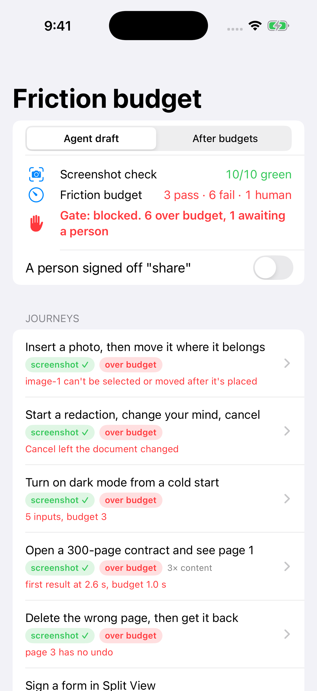
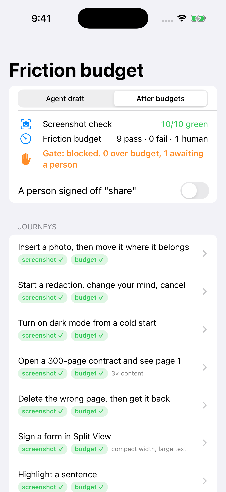
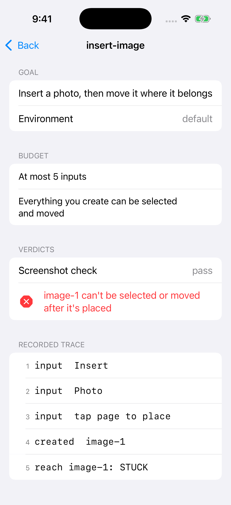

# FrictionBudget

**User journeys written as friction budgets a coding agent can be measured against.**

Coding agents usually verify UI by looking at a final screenshot. Users judge it by trying to get something done. FrictionBudget turns "make it intuitive" into checkable limits: inputs to task, time to first result at 3× content, whether everything you create can be reached again, whether Cancel leaves the document untouched, whether destructive actions have an undo, and whether required controls are hittable in the journey's environment (Split View, large text).

Article: (added after publish)

Inspired by Niels Mündler, [LLMs still cannot detect bad UX](https://blog.nielstron.de/2026/10/08/the-remaining-shortcomings-of-coding-agents/) (8 Oct 2026).



## What's in it

| Type | What it does |
|------|--------------|
| `Journey`, `Budget` | A user goal plus the friction it may cost. `nil` limits aren't checked; negative limits clamp to 0. A journey can be marked `needsHumanReview`, so it can never pass on its own. |
| `Trace`, `Event`, `Environment` | What an interaction-level test records: inputs, first result, created objects and later reach attempts, destructive actions with or without undo, state digests around a cancel, controls that weren't hittable. |
| `TraceMetrics` | Numbers derived from the events, never self-reported by the build under test. |
| `FrictionCheck` | Every budget line a trace breaks, in budget order. A cancel journey without before/after digests is `cancelUnverified`, not a pass. |
| `ScreenshotOracle` | A deliberately generous model of screenshot verification: goal visible at the end, clipping checked only in the default environment. |
| `FrictionGate`, `GateSummary` | Rows per journey, and a ship/blocked decision. A journey with no trace blocks the release. Human sign-off is required for journeys marked for review. |
| `SampleScenario` | **A constructed example**: ten journeys for a small iOS PDF-markup app, with hand-written traces for an "agent draft" build and an "after budgets" build. Not recordings of a real app or agent. |

```swift
let journey = Journey(id: "insert-image",
                      goal: "Insert a photo, then move it where it belongs",
                      budget: Budget(maxInputs: 5, everyCreationReachable: true))

let violations = FrictionCheck.violations(of: journey, in: trace)
// agent draft: [.stuckCreation("image-1")]
```

On the constructed scenario, the screenshot check passes 10 of 10 journeys. The friction budget fails 6 (one each of reachability, cancel, inputs, latency, undo and layout), passes 3, and holds 1 for a person. The tests assert each of those violations.

In a real pipeline, an XCUITest would play each journey and record the trace. This repo stops at the checker and ships traces in that format.

## How to run it

1. `git clone https://github.com/rajatslakhina/friction-budget-article-demo`
2. Open `Demo.xcodeproj` in Xcode.
3. Pick the `Demo` scheme and any iPhone Simulator, then Build & Run.

No other setup: the app consumes the library through a local package reference in the same repo. Library only: `swift build && swift test`.

## Verification status

- `swift build -Xswiftc -warnings-as-errors` and `swift test` pass (Swift 6.1.2 on Linux, and macos-15 in GitHub Actions).
- The `demo-on-simulator` CI job builds `Demo.xcodeproj` for the iOS Simulator, installs and launches the app, fails if it isn't still running after 8 seconds, and commits the screenshots in `Demo/Screenshots/`. Those screenshots come from CI. Nobody tapped through the UI by hand.
- Article visuals in `docs/` are rendered in CI from the HTML sources in `docs/src/`.

## Screenshots

| Agent draft | After budgets | Journey detail |
|---|---|---|
|  |  |  |
